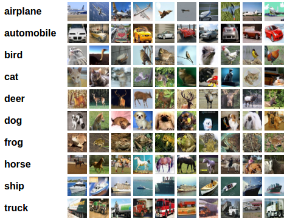

# Lab 1 · Thực hành phân loại ảnh CIFAR-10 với CNN PyTorch

## Mục tiêu

Trong bài thực hành này, xây dựng và kiểm tra một pipeline phân loại ảnh hoàn chỉnh:

`load dữ liệu → chuẩn hóa → xem batch ảnh → xây dựng CNN → train → lưu model → inference → đánh giá`

Sau khi hoàn thành, học viên có thể:

- tải và chuẩn hóa CIFAR-10 bằng `torchvision`;
- đọc dữ liệu theo mini-batch bằng `DataLoader`;
- xây dựng CNN bằng `torch.nn`;
- viết vòng lặp huấn luyện với `CrossEntropyLoss` và SGD;
- lưu/nạp trọng số bằng `state_dict`;
- tính accuracy trên tập test và accuracy theo từng lớp;
- nhận biết bước cần thay đổi khi chuyển model sang GPU hoặc thiết bị edge.

## Bài toán

CIFAR-10 gồm ảnh màu kích thước `3×32×32` thuộc 10 lớp:

```text
plane, car, bird, cat, deer, dog, frog, horse, ship, truck
```



*Hình 1. Ví dụ các lớp ảnh trong CIFAR-10.*

Model nhận một batch ảnh có shape `[batch_size, 3, 32, 32]` và trả về 10 logits cho mỗi ảnh. Lớp có logit lớn nhất là lớp được dự đoán.

## Mã nguồn đi kèm

Hai file dưới đây là phiên bản chạy được của bài thực hành:

- [Notebook CIFAR-10](cifar10_tutorial.ipynb) — chạy từng cell và quan sát kết quả.
- [Script Python CIFAR-10](cifar10_tutorial.py) — chạy toàn bộ pipeline từ terminal.

Hai file cung cấp cùng một pipeline phân loại ảnh, gồm tải dữ liệu, huấn luyện, lưu model và đánh giá.

## 1. Chuẩn bị môi trường

Từ thư mục gốc của repository, tạo môi trường ảo và cài các thư viện:

```bash
python3 -m venv .venv
source .venv/bin/activate
python -m pip install --upgrade pip
python -m pip install torch torchvision matplotlib numpy jupyter
```

Trên Windows PowerShell, kích hoạt môi trường bằng:

```powershell
.venv\Scripts\Activate.ps1
```

Kiểm tra cài đặt:

```bash
python -c "import torch, torchvision; print(torch.__version__, torchvision.__version__)"
```

Nếu đã có môi trường PyTorch của khóa học, có thể bỏ qua bước cài đặt. Lệnh tải `torch`/`torchvision` cho GPU phụ thuộc vào CUDA và thiết bị; hãy dùng lệnh phù hợp với môi trường của bạn.

## 2. Chạy bài thực hành

### Cách 1: chạy script

Chạy từ thư mục gốc repository:

```bash
python docs/modules/01-edge-ai-introduction/cifar10_tutorial.py
```

Lần chạy đầu tiên sẽ tải CIFAR-10 vào thư mục `data/`. Sau khi train, model được lưu ở `cifar_net.pt`.

### Cách 2: chạy notebook

```bash
jupyter notebook docs/modules/01-edge-ai-introduction/cifar10_tutorial.ipynb
```

Chạy các cell theo thứ tự từ trên xuống dưới. Notebook phù hợp để quan sát batch ảnh, nhãn thật, nhãn dự đoán và kết quả accuracy.

!!! note "Nếu DataLoader bị lỗi trên Windows hoặc macOS"
    Đổi `num_workers=2` thành `num_workers=0` trong cả `trainloader` và `testloader`. Trên máy edge, bắt đầu với `0` để giảm vấn đề tương thích, sau đó mới thử tăng số worker.

## 3. Đọc và chuẩn hóa dữ liệu

Đoạn code chính trong bài sử dụng `torchvision.datasets.CIFAR10` và transform của `torchvision`:

```python
import torch
import torchvision
from torchvision.transforms import v2

transform = v2.Compose([
    v2.ToImage(),
    v2.ToDtype(torch.float32, scale=True),
    v2.Normalize((0.5, 0.5, 0.5), (0.5, 0.5, 0.5)),
])

batch_size = 4

trainset = torchvision.datasets.CIFAR10(
    root="./data",
    train=True,
    download=True,
    transform=transform,
)
trainloader = torch.utils.data.DataLoader(
    trainset,
    batch_size=batch_size,
    shuffle=True,
    num_workers=2,
)

testset = torchvision.datasets.CIFAR10(
    root="./data",
    train=False,
    download=True,
    transform=transform,
)
testloader = torch.utils.data.DataLoader(
    testset,
    batch_size=batch_size,
    shuffle=False,
    num_workers=2,
)
```

Sau khi chạy:

1. `trainset` có ảnh và nhãn dùng để cập nhật trọng số.
2. `testset` chỉ dùng để đánh giá, không được dùng để train.
3. Ảnh ban đầu có giá trị trong `[0, 1]`; `Normalize` đưa giá trị về gần `[-1, 1]` theo từng kênh màu.
4. `shuffle=True` chỉ được dùng cho tập train.

Hiển thị một batch bằng cách hoàn tác chuẩn hóa trước khi vẽ:

```python
def imshow(img):
    img = img / 2 + 0.5
    npimg = img.numpy()
    plt.imshow(np.transpose(npimg, (1, 2, 0)))
    plt.show()


dataiter = iter(trainloader)
images, labels = next(dataiter)
imshow(torchvision.utils.make_grid(images))
print(" ".join(f"{classes[labels[j]]:5s}" for j in range(batch_size)))
```

Kiểm tra shape trước khi xây dựng model:

```python
print(images.shape)  # torch.Size([4, 3, 32, 32])
print(labels.shape)  # torch.Size([4])
```

## 4. Xây dựng CNN

Mô hình CNN trong bài gồm hai lớp tích chập và ba lớp tuyến tính:

```text
Conv2d(3, 6, 5) → ReLU → MaxPool2d
Conv2d(6, 16, 5) → ReLU → MaxPool2d
Flatten → Linear(16×5×5, 120) → ReLU
         → Linear(120, 84) → ReLU
         → Linear(84, 10)
```

Mã nguồn:

```python
import torch.nn as nn
import torch.nn.functional as F


class Net(nn.Module):
    def __init__(self):
        super().__init__()
        self.conv1 = nn.Conv2d(3, 6, 5)
        self.pool = nn.MaxPool2d(2, 2)
        self.conv2 = nn.Conv2d(6, 16, 5)
        self.fc1 = nn.Linear(16 * 5 * 5, 120)
        self.fc2 = nn.Linear(120, 84)
        self.fc3 = nn.Linear(84, 10)

    def forward(self, x):
        x = self.pool(F.relu(self.conv1(x)))
        x = self.pool(F.relu(self.conv2(x)))
        x = torch.flatten(x, 1)
        x = F.relu(self.fc1(x))
        x = F.relu(self.fc2(x))
        return self.fc3(x)


net = Net()
```

Không thêm `Softmax` vào cuối `Net`: `CrossEntropyLoss` nhận logits và tự xử lý phần tương ứng trong loss.

## 5. Huấn luyện model

Khai báo loss và optimizer:

```python
import torch.optim as optim

criterion = nn.CrossEntropyLoss()
optimizer = optim.SGD(net.parameters(), lr=0.001, momentum=0.9)
```

Mỗi batch thực hiện đúng thứ tự:

`zero_grad → forward → tính loss → backward → optimizer.step`

```python
for epoch in range(2):
    running_loss = 0.0

    for i, data in enumerate(trainloader, 0):
        inputs, labels = data

        optimizer.zero_grad()
        outputs = net(inputs)
        loss = criterion(outputs, labels)
        loss.backward()
        optimizer.step()

        running_loss += loss.item()
        if i % 2000 == 1999:
            print(
                f"[{epoch + 1}, {i + 1:5d}] "
                f"loss: {running_loss / 2000:.3f}"
            )
            running_loss = 0.0

print("Finished Training")
```

Lưu trọng số sau khi train:

```python
PATH = "./cifar_net.pt"
torch.save(net.state_dict(), PATH)
```

## 6. Inference và đánh giá

Nạp lại model từ file checkpoint rồi dự đoán một batch của tập test:

```python
net = Net()
net.load_state_dict(torch.load(PATH, weights_only=True))

dataiter = iter(testloader)
images, labels = next(dataiter)

with torch.no_grad():
    outputs = net(images)
    _, predicted = torch.max(outputs, 1)

print("GroundTruth:", " ".join(
    f"{classes[labels[j]]:5s}" for j in range(4)
))
print("Predicted:  ", " ".join(
    f"{classes[predicted[j]]:5s}" for j in range(4)
))
```

Đánh giá accuracy trên toàn bộ test set:

```python
correct = 0
total = 0

net.eval()
with torch.no_grad():
    for images, labels in testloader:
        outputs = net(images)
        _, predicted = torch.max(outputs, 1)
        total += labels.size(0)
        correct += (predicted == labels).sum().item()

print(f"Accuracy: {100 * correct / total:.2f}%")
```

Accuracy ngẫu nhiên của bài toán 10 lớp là khoảng `10%`. Kết quả cụ thể thay đổi theo phiên bản thư viện, seed, số epoch và phần cứng; không dùng một con số cố định để kết luận model tốt hay xấu.

Đánh giá riêng từng lớp giúp phát hiện lớp model nhận diện tốt hoặc kém:

```python
correct_pred = {classname: 0 for classname in classes}
total_pred = {classname: 0 for classname in classes}

with torch.no_grad():
    for images, labels in testloader:
        outputs = net(images)
        _, predictions = torch.max(outputs, 1)

        for label, prediction in zip(labels, predictions):
            if label == prediction:
                correct_pred[classes[label]] += 1
            total_pred[classes[label]] += 1

for classname, correct_count in correct_pred.items():
    accuracy = 100 * correct_count / total_pred[classname]
    print(f"Accuracy for class: {classname:5s} is {accuracy:.1f} %")
```

## Tài liệu tham khảo

[PyTorch — Training a Classifier with CIFAR-10](https://docs.pytorch.org/tutorials/beginner/blitz/cifar10_tutorial.html)
